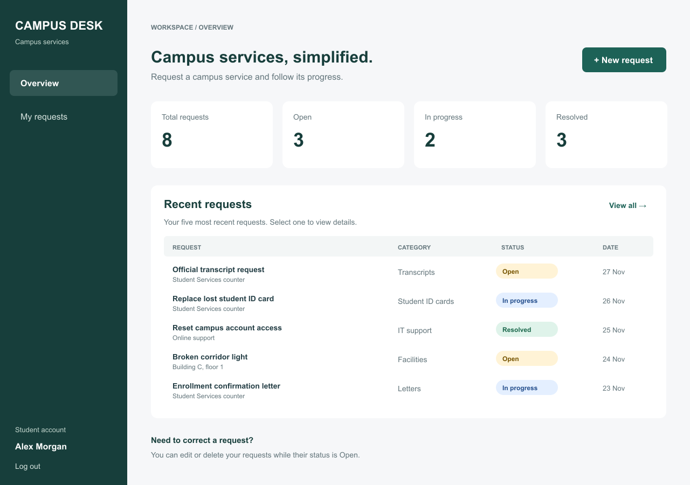
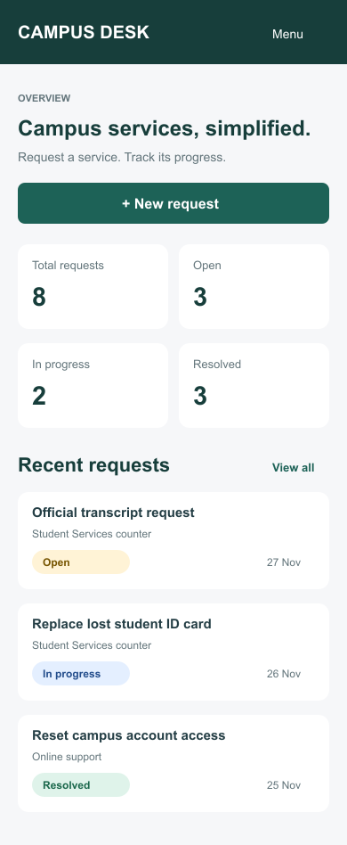
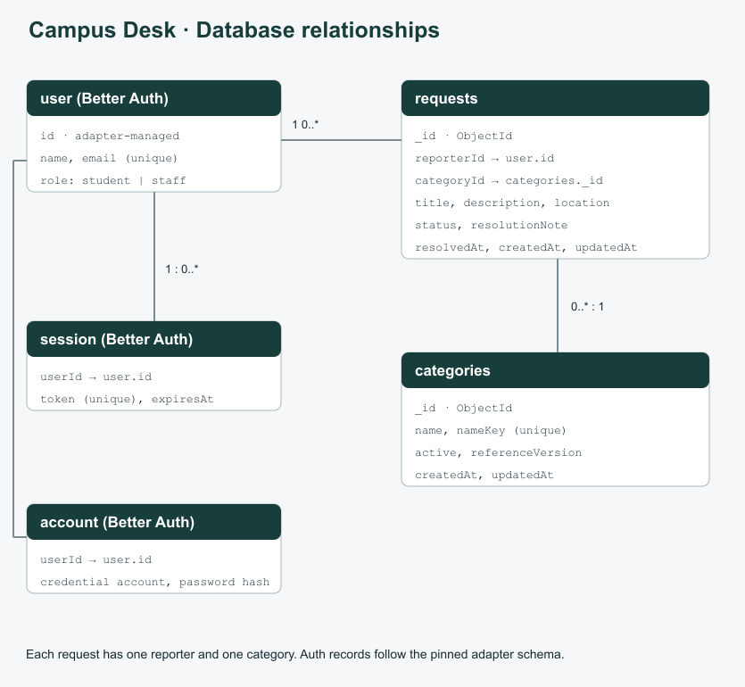
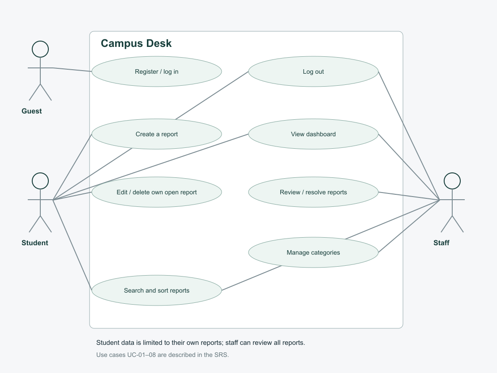

# Software Requirements Specification
## Campus Desk
Version 1.0

**Created:** 27 November 2026

## Revision History
| Version | Date | Change |
| --- | --- | --- |
| 1.0 | 27 November 2026 | Initial product requirements, use cases, API contract, database and interface design. |

## Table of Contents
The table of contents in the Word and PDF versions lists all numbered sections and appendices with page numbers.

# 1. Introduction
## 1.1 Purpose
This SRS defines the first release of Campus Desk, a website where students request campus services and staff track their completion. It defines the behavior, interfaces, data and acceptance criteria for the first release.

## 1.2 Document Conventions
**FR** identifies a functional requirement; **NFR** identifies a quality requirement; **UC** identifies a use case; **AT** identifies an acceptance check. Every listed requirement is required for the first release unless marked as an open decision. “Shall” describes behavior that must be demonstrated. Student means a registered reporter. Staff means a campus service coordinator. A request means one campus service request.

## 1.3 Intended Audience and Reading Suggestions
Product reviewers can read Section 1, **Appendix C** and **Appendix D** to assess scope and coverage. Developers should read all sections, particularly the permission rules and API contract. Testers should use Section 4, **Appendix A** and **Appendix D**. The interface design and database diagram are included with this document.

## 1.4 Product Scope
Campus Desk replaces an informal list of campus service requests with a small shared workflow. A student requests a transcript, a replacement student ID card, IT help or a facility repair, sees its status, and can correct or delete the report while it is still open. Staff see all reports, update progress, and maintain categories. Both roles receive a dashboard with relevant counts and recent requests.

Categories are created by staff rather than fixed in code. Example starting categories are Transcripts, Student ID cards, IT support and Facilities. Each category uses the same form and status workflow. The website tracks the request; staff prepare documents or provide the service outside it. It does not issue official transcripts or identity cards.

The first release includes registration, login, logout, two roles, request CRUD, category CRUD, sorting, filtering, a dashboard and a deployed release. It excludes payments, attachments, chat, email delivery, automatic assignment, maps, multiple campuses and public reporting. These features are outside the first release.

## 1.5 References
Supporting project documents are the API contract in Section 3.2, database design in **Appendix B**, use cases in **Appendix C**, and acceptance criteria in **Appendix D**. These form part of this specification.

# 2. Overall Description
## 2.1 Product Perspective
Campus Desk is a standalone campus service application. A React interface sends same-origin HTTPS requests to Next.js Route Handlers running on Node.js. Those handlers check the session, permissions and input before reading or writing MongoDB. Better Auth handles credentials and sessions through its MongoDB adapter. The browser never connects directly to MongoDB.

## 2.2 Product Functions
Students can register, log in, log out, create reports, browse their own reports, change or delete open reports, and view their own dashboard. Staff can browse all reports, change their status and resolution note, manage categories, and view overall counts. Lists support category and status filters, title search, and sorting.

## 2.3 User Classes and Characteristics
| Action | Guest | Student | Staff |
| --- | --- | --- | --- |
| Register or log in | Yes | Already signed in | Already signed in |
| View dashboard | No | Own requests | All requests |
| Create request | No | Yes | No |
| Read request | No | Own only | All |
| Edit title, description, location, category | No | Own open requests | No |
| Delete request | No | Own open requests | No |
| Change status and resolution note | No | No | Yes |
| Read active categories | No | Yes | Yes |
| Create, edit, delete categories | No | No | Yes |
| Log out | No | Yes | Yes |

Staff accounts are provisioned through a local administrative seed command. Public registration always creates a student. The website exposes no role-change feature. Staff do not need student identities beyond the reporter name needed to follow up; API responses shall not disclose passwords, session tokens or authentication records.

## 2.4 Operating Environment
The application shall run as one Next.js app on Vercel Hobby, using the Node.js runtime for API routes. MongoDB Atlas Free shall provide the persistent database. Vercel hosts both the React interface and the backend API; no separate Node.js host is required. Development shall use a supported Node.js LTS release and a MongoDB replica set. The database shall support the transactions used for account creation and category relationships. Exact compatible versions shall be pinned in the package lockfile during setup. The UI shall support current stable desktop Chrome, Firefox and Safari, and mobile Chrome/Safari at the time of testing. All visible UI and project documentation shall use English.

## 2.5 Design and Implementation Constraints
The application shall use Next.js, TypeScript, MongoDB's official driver, Better Auth, Zod and Tailwind CSS. React is supplied through Next.js. Use the Better Auth MongoDB adapter compatible with the pinned Better Auth version. Tailwind utility classes shall define responsive layouts, spacing and visual styles. The interface shall be checked at 360, 768 and 1440 CSS pixels. Use native fetch and ordinary React state; no separate Express server, ORM, state library or additional UI component framework is required.

The team shall implement explicit REST endpoints so that server logic and frontend/API integration can be demonstrated. Development shall use small signed conventional commits. Credentials and environment files shall stay out of Git.

# 3. External Interface Requirements
## 3.1 User Interfaces
The required routes are `/register`, `/login`, `/dashboard`, `/requests`, `/requests/new`, `/requests/[id]`, `/requests/[id]/edit` and `/categories.` The final route is staff-only. A role-aware navigation bar shall expose permitted pages and a working logout control. Direct navigation to a protected page shall require authentication and authorization.

The main dashboard design is attached as dashboard-desktop.svg and dashboard-mobile.svg. These define the layout of the dashboard. The student dashboard shows total, open, in-progress and resolved counts, a New request button, and recent requests. Staff see the same counts for all reports, a review link and category management navigation. Each request row links to its details. Use text alongside color for every status.

Forms shall use visible labels, field-level errors and a clear submit state. A failed save shall retain entered values. Empty lists shall explain how to create or find a request. A failed load shall show a retry control. Deletion shall require a confirmation dialog. On narrow screens, request rows become cards; the page shall not require horizontal scrolling. Keyboard users shall be able to reach and use all controls with a visible focus indicator.

## 3.2 Software Interfaces
All business endpoints use `/api.` Requests and responses use JSON, except successful deletions with no body. IDs are strings in JSON. Times use UTC ISO 8601 strings. Authentication uses a secure HTTP-only session cookie; JavaScript shall not store session tokens in `localStorage`. API clients send the cookie on same-origin requests.

Business success responses use {data: ...}; lists also return page, `pageSize` and total. Business errors use {error: {code, message, fields?}}. fields maps input names to readable errors. Never include stack traces or database details. Authentication endpoints retain Better Auth's documented response format and are called through its client; they do not use the business wrapper.

| Method and endpoint | Access | Input | Success |
| --- | --- | --- | --- |
| POST `/api/auth/sign-up/email` | Guest | `name`, `email`, `password` | Better Auth registration response; student `role` |
| POST `/api/auth/sign-in/email` | Guest | `email`, `password` | Better Auth session response and cookie |
| POST `/api/auth/sign-out` | Signed in | Empty object | Better Auth success; session invalidated |
| GET `/api/auth/get-session` | Any | None | Better Auth session/user or null |
| GET `/api/requests` | Signed in | `q`, `status`, `categoryId`, `sort`, `page`, `pageSize` | 200; scoped paginated Request summaries |
| POST `/api/requests` | Student | `title`, `description`, optional `location`, `categoryId` | 201; created Request |
| GET `/api/requests/{id}` | Owner or staff | Valid request ID | 200; Request detail |
| PATCH `/api/requests/{id}` | Owner of `open` request | One or more editable report fields | 200; updated Request |
| DELETE `/api/requests/{id}` | Owner of `open` request | None | 204; no body |
| PATCH `/api/requests/{id}/status` | Staff | `status`, `resolutionNote` | 200; updated Request |
| GET `/api/categories` | Signed in | None | 200; `active` categories for students; all for staff |
| POST `/api/categories` | Staff | `name` | 201; Category |
| PATCH `/api/categories/{id}` | Staff | `name` and/or `active` | 200; Category |
| DELETE `/api/categories/{id}` | Staff | None | 204 if no requests reference it; 409 otherwise |
| GET `/api/dashboard` | Signed in | None | 200; counts and five recent requests in `role` scope |

Request summaries contain `id`, `title`, `location`, `status`, `category` {`id`, `name`}, `createdAt` and `updatedAt`. Staff summaries also contain `reporter` {`id`, `name`}. Details add `description`, `reporter`, `resolutionNote` and `resolvedAt`. Student detail responses disclose only their own `reporter` `data`. Category responses contain `id`, `name`, `active`, `createdAt` and `updatedAt`. Dashboard responses contain `counts` {`total`, `open`, `inProgress`, `resolved`} and `recentRequests` in summary form.

**List defaults:** `page`=1, `pageSize`=10, `sort`=`newest`. `pageSize` is 1-50; `page` is a positive integer. `q` is a literal `title` substring of at most 100 characters, not a regular expression supplied by the client. `status` accepts `open`, `in_progress` or `resolved`. `sort` accepts `newest`, `oldest`, `title_asc` or `title_desc`; ties use `id` for stable ordering. Filters combine with AND. Empty matches return `data`=[] and `total`=0. Student ownership filtering applies before totals, sorting and pagination.

A create example is `{"title":"Official transcript request","description":"I need an official transcript for an internship application.","location":"Student Services counter","categoryId":"507f1f77bcf86cd799439011"}`. An omitted `location` is stored as an empty string. The server supplies `reporterId`, `status`=`open`, `resolutionNote`="", `resolvedAt`=null and timestamps. It ignores no protected input silently: `reporterId`, `role`, `status` and unknown body fields shall be rejected.

A `status` example is `{"status":"resolved","resolutionNote":"The transcript is ready for collection."}. The response uses the Request detail shape. A validation error example is {"error":{"code":"VALIDATION_ERROR","message":"Check the highlighted fields.","fields":{"title":"Enter 5 to 120 characters."}}}`.

**Business status codes:** 400 for invalid JSON, IDs, fields or query values; 401 for missing/expired sessions; 403 for a disallowed role; 404 for missing requests or another student's request; 409 for a locked request, invalid status transition, duplicate category or referenced category deletion; 413 for a JSON body above 16 KiB; 500 for an unexpected failure; 503 for database unavailability. Rate-limited auth requests use 429 through the auth library. Duplicate registration and login errors shall follow the pinned auth library's documented behavior without revealing credentials.

# 4. System Features
## 4.1 Authentication and Authorization
### 4.1.1 Description and Priority
The system provides account registration, login and logout. It distinguishes students from staff and checks both role and ownership before allowing access to protected data. This feature is required because all requests belong to an identified student and staff have different permissions.

**Priority:** High. Required for the first release.

### 4.1.2 Stimulus/Response Sequences
A guest submits registration details. The system validates them, creates a student account and starts a session. An existing account submits credentials to log in. A signed-in account selects Log out, and the system revokes the session.

### 4.1.3 Functional Requirements

**FR-01:** The system shall provide working registration, login and logout backed by MongoDB and Better Auth. The library shall hash passwords; plaintext passwords shall never be saved or logged.

**FR-02:** Registration shall accept a trimmed name of 2-80 characters, a valid email of at most 254 characters, and a password of 12-128 characters. Email shall be normalized consistently and protected by a unique index. Public role input shall be rejected. Library hooks or configuration shall enforce these rules on direct auth calls too.

**FR-03:** Every protected API request shall check a valid session and the current database role. A student shall never obtain another student's reports by changing an ID or query. Session lifetime shall be seven days without sliding renewal for the first release; logout shall revoke the current session immediately.

**FR-04:** Staff shall be created by an idempotent administrative seed command, using credentials supplied outside Git. No password reset, email verification or social login is included in the first release. Verification shall use synthetic accounts and requests.

## 4.2 Student Request CRUD
### 4.2.1 Description and Priority
Students can create, read, edit and delete their own campus service requests. Editing and deletion are available only while a request is open. This feature is the main way students ask for a service and correct their information before staff begin work.

**Priority:** High. Required for the first release.

### 4.2.2 Stimulus/Response Sequences
A student selects New request, enters the required information and submits it. The system validates and saves an open request, then shows its details. When the owner edits or confirms deletion, the system checks that the request is still open before applying the change.

### 4.2.3 Functional Requirements

**FR-05:** A student shall create a report with a trimmed title of 5-120 characters, description of 20-2000 characters, optional location or collection point of 0-120 characters and an existing active category. Text shall be treated as plain text.

**FR-06:** Students shall list and read only their own reports, including category names and status. Report ownership shall come from the session and shall not be editable.

**FR-07:** Students shall edit or delete only their own open reports. Permission and current status shall be included in the database write condition so a concurrent staff update cannot be overwritten. A failed condition shall leave the document unchanged and return the appropriate 404 or 409 response. Retaining an unchanged inactive category on an existing request is allowed; selecting a different category requires an active one.

**FR-08:** Deleting a request shall remove that request only. It shall not remove users or categories. A rejected or failed save shall not change existing data.

## 4.3 Staff Review and Status Updates
### 4.3.1 Description and Priority
Staff can review every request and move it from open to in progress and then resolved. A resolution note tells the student what was completed or where to collect a document. This feature is required to track work and provide a clear outcome.

**Priority:** High. Required for the first release.

### 4.3.2 Stimulus/Response Sequences
Staff open a request and select Mark in progress. The system saves the status and displays the update. Staff later enter a resolution note and select Mark resolved. The system validates the transition, records the completion time and makes the result visible to the student.

### 4.3.3 Functional Requirements

**FR-09:** Staff shall read all reports and their reporter names. They shall not rewrite the student's original report or delete it.

**FR-10:** The allowed transitions shall be `open` to `in_progress` and `in_progress` to `resolved`. No reopening or skipping is included. A resolution requires a trimmed note of 5-1000 characters. An in-progress update allows an empty note or up to 1000 characters. The server shall record `resolvedAt` when resolved and update `updatedAt` atomically. Invalid or concurrent transitions shall return 409 without changing the document.

## 4.4 Category CRUD
### 4.4.1 Description and Priority
Staff can create, read, rename, deactivate and delete service categories. Students select an active category when submitting a request. Referenced categories remain available for historical requests. This feature lets the service list change without changing application code.

**Priority:** High. Required for the first release.

### 4.4.2 Stimulus/Response Sequences
Staff enter a category name and select Add category. The system checks uniqueness and saves it. Staff may rename or deactivate it. On deletion, the system checks for existing requests and either deletes the unused category or explains that it must be deactivated instead.

### 4.4.3 Functional Requirements

**FR-11:** Staff shall manage categories with trimmed names of 2-60 characters and case-insensitive uniqueness. New categories start active. Blank or duplicate names shall be rejected. The app shall enforce role checks on all category mutations.

**FR-12:** A referenced category shall not be deleted. Staff shall deactivate it instead; historical requests shall still display its name. Category deletion and new request references shall be coordinated in a transaction that also writes the category document, preventing a concurrent delete from leaving a dangling reference. Deactivation and request creation shall use the same coordination. The MongoDB deployment shall support transactions.

## 4.5 Search, Sorting and Dashboard
### 4.5.1 Description and Priority
Signed-in users can search, filter, sort and page through the requests they are allowed to see. The dashboard shows counts by status and the five newest accessible requests. This feature helps students follow their requests and staff find work that needs attention.

**Priority:** High. Required for the first release.

### 4.5.2 Stimulus/Response Sequences
A user enters search terms or chooses filters and a sort order, then selects Apply. The system returns a page of matching requests within that account's access. When the user opens the dashboard, the system returns the same account's status counts and recent requests.

### 4.5.3 Functional Requirements

**FR-13:** The system shall implement the list contract in Section 3.2 on the server. Page controls shall retain the active filters and sort; changing a filter shall reset to page 1.

**FR-14:** Each dashboard shall show total, open, in-progress and resolved counts plus the five newest accessible requests. Counts shall use the same role scope as the list. Counts shall sum to total. After a mutation, the UI shall refresh relevant data; live push updates are outside scope.

# Appendix A. Quality Requirements
**NFR-01:** At 360, 768 and 1440 CSS pixels, all primary flows shall remain usable without page-level horizontal scrolling. Form controls shall have visible labels, keyboard support and visible focus; text contrast shall meet WCAG AA targets.

**NFR-02:** All writes shall validate JSON, lengths, IDs, enums, allowed keys and permissions on the server. The application shall build MongoDB queries from allowed fields and shall never pass client objects directly to database filters or updates. Render report text through React's escaped text output.

**NFR-03:** Production shall use HTTPS, Secure/HttpOnly/SameSite cookies, trusted-origin checks on mutations, and Better Auth's CSRF protections. Auth throttling shall use a persistent shared store supported by the pinned library, with a target of five failed sign-in attempts per minute per IP. Secrets remain server-only. Private API/page data shall not be placed in a shared public cache.

**NFR-04:** With 1,000 synthetic requests and ten concurrent signed-in users, at least 95% of warmed list/dashboard requests shall finish within two seconds in a documented test environment. Cold-start time shall be reported separately. This is a test target, not a measured result.

**NFR-05:** Database failures shall show a readable retry message without claiming a write succeeded. Controls shall prevent duplicate form submission while pending; server constraints shall still protect uniqueness and write permissions.

**NFR-06:** The deployed site shall survive an application restart without losing saved reports. The team shall keep secrets out of source control, restrict database credentials to the application database, and log server errors without request passwords, tokens or full report bodies.

# Appendix B. Database Design

MongoDB references express the required database relationships; MongoDB does not provide automatic foreign-key enforcement. Application checks and transactions shall maintain valid references. Authentication IDs shall use the pinned adapter's ID type consistently; the app shall not assume all auth IDs are MongoDB ObjectIds.

| Collection | Main fields and constraints |
| --- | --- |
| `user` | Adapter-managed id, `name`, `email`, `emailVerified`, timestamps; custom `role` enum student/staff with server-only writes and student default. Unique normalized `email`. |
| `account` | Adapter-managed credential account linked by `userId`; `password` hash managed by Better Auth. Never returned by business APIs. |
| `session` | Adapter-managed `userId`, unique `token` and expiry; managed by Better Auth. Expiry checked during authentication, independent of TTL cleanup. |
| `verification` | Reserved adapter-managed verification records when required by the pinned library. No `email` workflow in this release. |
| `categories` | `ObjectId` `_id`; `name`; `nameKey`=trimmed lowercase `name` with unique index; `active` boolean; internal `referenceVersion` integer for write coordination; `createdAt`; `updatedAt`. |
| `requests` | `ObjectId` `_id`; `reporterId` referencing user; `categoryId` referencing categories; `title`; `description`; `location`; `status` enum; `resolutionNote`; `resolvedAt` nullable; `createdAt`; `updatedAt`. |

One user has zero or many requests, accounts and sessions. One category has zero or many requests. Every request has exactly one reporter and one category. User deletion is outside scope, so report ownership cannot be orphaned through the application. Category renaming changes the displayed name on existing requests.

Indexes shall include `categories.nameKey` unique; `requests(reporterId, createdAt, _id)`; `requests(status, createdAt, _id)`; and `requests(categoryId)`. Auth indexes shall follow the adapter schema and be ready before accepting traffic. Title substring search may scan the initial dataset; add a search index only if measured dataset growth needs it. No upload or binary data is stored.

# Appendix C. Use Cases

| ID and actor | Preconditions | Main flow and result | Alternate or failure |
| --- | --- | --- | --- |
| UC-01 Guest: register | Signed out | Enter name/email/password; validate; create student; open dashboard. | Invalid input shows fields; failed creation leaves no usable partial account. |
| UC-02 Student/staff: log in/out | Account exists | Submit credentials; start session; show correct dashboard; log out; revoke session. | Invalid credentials show a generic error; revoked/expired session cannot call private APIs. |
| UC-03 Student: create report | Signed in; active category exists | Enter report fields; save; view created report. | Invalid or deactivated category is rejected; entered values remain. |
| UC-04 Student: manage own report | Own open report exists | Open details; edit and save, or confirm deletion; list reflects change. | Another owner's ID returns 404; status changed by staff returns 409. |
| UC-05 Staff: resolve report | Report exists | Read all reports; start work; enter resolution note; resolve. | Student calls return 403; invalid transition returns 409; missing note returns 400. |
| UC-06 Staff: manage categories | Staff session | Create category; rename; deactivate; delete if unused. | Duplicate name or referenced deletion returns 409; references remain valid. |
| UC-07 Student/staff: find reports | Signed in | Open list; search/filter/sort/page; open an accessible record. | No matches show an empty state; invalid query returns 400. |
| UC-08 Student/staff: view dashboard | Signed in | Load permitted counts and five recent reports; navigate to details. | Database failure shows retry; no reports shows zero counts. |

# Appendix D. Acceptance Criteria
The release shall pass the following acceptance checks. Verification results shall be recorded separately.

| Check | Expected evidence | Requirements |
| --- | --- | --- |
| AT-01 Registration/login/logout | Register a fresh student; reject invalid input; log in; log out; replay a private request and receive 401. Confirm a password hash in the database without exposing it. | FR-01-04; authentication and Node.js logic |
| AT-02 Role and ownership | Two students and one staff account; student A cannot read/update/delete B's report, list it or count it. Direct staff API calls by a student fail. Forged role/owner input fails. | FR-02-03, 06-09; multi-user roles |
| AT-03 Request CRUD | Create, read, edit and delete an open request through the UI and verify persisted changes in MongoDB. Reject invalid fields and locked edits; race a staff status update against a student edit. | FR-05-08; CRUD and integration |
| AT-04 Workflow | Move open to `in_progress` to resolved; require resolution note; reject skipped/repeated transitions. Owner sees updates. | FR-09-10; server logic |
| AT-05 Categories and relationships | Create, read, rename and delete an unused category; reject referenced deletion; deactivate it and retain historical name. Race creation against category deletion/deactivation and verify valid references. | FR-11-12; CRUD and database relationships |
| AT-06 Sorting and filtering | Seed distinct dates/titles; demonstrate all four sort modes, combined filters, empty state, pagination, invalid queries and ownership-scoped totals. | FR-13; MongoDB sorting |
| AT-07 Dashboard | Compare each role's counts and five newest records with the scoped dataset before and after changes; check counts sum to total. | FR-14; dashboard |
| AT-08 Responsive access | Complete login, create, edit, delete and staff review at 360/768/1440 px; check keyboard use and readable validation/errors. | NFR-01-02; responsive UI |
| AT-09 Security and failures | Reject unknown keys, injected query objects, oversized JSON, untrusted origins and expired sessions. Check auth throttling, cookie flags, private caching and database outage feedback. | NFR-02-03, 05-06; validation and auth |
| AT-10 Performance and deployment | Run the defined load check; record environment/results. Open deployed HTTPS URL, use both roles, save a report, restart app and verify persistence. | NFR-04-06; deployment and end-to-end verification |
| AT-11 Documentation | Supply this SRS with use cases, API contract, database/interface designs, deployed URL and signed Git history. | Release documentation and Git |

# Appendix E. Delivery Plan and Open Decisions
The first release shall be delivered in five stages: application and database setup; authentication and access control; request and category management; responsive interface and dashboard; verification and deployment.

The backend work includes authentication, permissions, validation, data integrity and API behavior. The frontend work includes navigation, forms, lists, dashboards and responsive styling. Integration and release checks cover the complete application.

**Open decisions:** production hosting provider, MongoDB hosting, production domain and release date. These decisions do not change the functional requirements.
